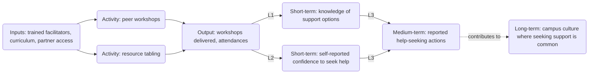

# Build Logic Model

Turn a program description into a theory of change (the reasoning for why the work should lead to change) and a logic model (the one-page chain from resources to results), with every causal step written so it can be checked, every outcome paired with a measurable indicator, and a plain statement of what the organization can and cannot claim. The finished model should survive a skeptical funder, guide the evaluation, and keep staff from promising outcomes the program cannot influence.

A theory of change explains why. A logic model shows what, in order. Build the theory first, then compress it into the model; a logic model with no stated reasoning is a list of hopes.

## Inputs to gather

Ask for, or retrieve from the organization's own documents, the following. When something is missing, proceed with a clearly labeled placeholder rather than inventing it.

- **Program description:** what staff and volunteers actually do, how often, for how long, with whom, and where (campus, school, community, online).
- **Population:** who the program serves, how they are reached, eligibility, age range (flag minors), and expected numbers per year.
- **Problem evidence:** the need the program responds to, with sources the organization can cite. Do not supply statistics from memory; mark any gap as "Source needed".
- **Resources:** staff roles and hours, contractors, partners, funding, tools, curricula, space.
- **Existing measurement:** any surveys, attendance logs, partner data, or prior reports, and when data collection started.
- **Funder or partner requirements:** required outcome areas, logic model template, or indicator lists, taken from the funder's own materials only.
- **Intended use:** grant application, board strategy, evaluation planning, or staff onboarding. This decides the level of detail.

Label every element with its evidence status:

- **Supplied:** stated by the user or found in the organization's documents (name the document).
- **Inferred:** a reasonable conclusion from supplied facts; say what it rests on.
- **Assumed:** a placeholder to confirm; write "Assumed:" before it.
- **Source needed:** a factual claim about the problem or population that requires a citation the organization must provide.

## Workflow

1. **Write the problem statement.** One paragraph: who is affected, what the condition is, why it persists, and what the program changes. Describe the population in people-first, strengths-aware language and use the organization's own audience phrasing where supplied. Avoid deficit framing ("at-risk youth" becomes "young people facing X barrier") unless the funder's required language says otherwise, in which case note it.
2. **Name the intended long-term change and work backward.** Ask "what must be true first?" repeatedly until you reach things the program directly does. This backward mapping keeps activities tied to outcomes instead of listing everything the team does. Read `references/theory-of-change-method.md` for backward mapping, preconditions, and the rules for outcome levels.
3. **Sort outcomes into levels.** Short-term outcomes are changes in knowledge, awareness, attitudes, skills, or confidence, usually measurable at or soon after participation. Medium-term outcomes are changes in behavior, practice, or intentions acted on, usually over months. Long-term outcomes are changes in conditions for a population, usually over years and shaped by many forces beyond the program. Place each outcome at exactly one level.
4. **Check outcome wording for clinical claims.** For mental-health, wellbeing, or crisis-adjacent programs, outcomes must describe what the program can measure without clinical assessment: participation, knowledge, self-reported confidence, attitudes, help-seeking intentions, reported help-seeking actions, connection to resources, and changes in environments or policies. Replace any wording that implies diagnosis, symptom reduction, treatment effect, or prevented deaths. Read `references/outcomes-and-indicators.md` for the rewrite table and indicator rules.
5. **Write each causal link as a testable if-then statement.** Format: "If [precondition] then [result], because [mechanism]." Each link should name an observable result and the assumption behind it, so evaluation can check whether it held. Mark links that rest on research evidence the organization can cite, on program experience, or on assumption only.
6. **List assumptions and external factors.** Assumptions are conditions the model needs to be true (partners allow access, participants attend enough sessions). External factors are forces outside program control that affect outcomes (campus policy, service availability, economic conditions, a major event). For each, note how the team would notice if it changed.
7. **Build the indicator plan.** For every outcome, at least one indicator with data source, collection frequency, baseline, target, and owner. Where no baseline exists, write "Baseline needed" and state when and how it will be collected; do not invent one. Targets are proposals for the team to confirm, labeled "Proposed target", and should follow from the baseline once it exists.
8. **Separate contribution from attribution.** Attribution means showing the program alone caused a change, which normally requires a design with a credible comparison. Contribution means showing a plausible, evidenced case that the program was one of the things that helped. Most nonprofit programs can credibly claim contribution to medium- and long-term outcomes and, at best, direct responsibility for outputs and some short-term outcomes. Read `references/contribution-and-claims.md` before writing the claims section or any language a funder will read.
9. **Draw the diagram.** Produce a Mermaid flowchart that mirrors the table: inputs to activities to outputs to outcomes by level, with assumptions noted. Keep labels short. Use rounded node syntax with quoted labels, for example `A("Trained peer facilitators")`, and avoid square or curly brackets in node text.
10. **Review with the team.** Suggest the three questions staff should answer before the model is used externally: which links they are least sure of, which indicators they can actually collect, and what a funder might challenge.

## Routing

- Read `references/theory-of-change-method.md` when building from scratch, when the program has many activities, or when the user asks for a theory of change narrative.
- Read `references/outcomes-and-indicators.md` when writing or reviewing outcomes and indicators, and always for mental-health, wellbeing, or youth programs.
- Read `references/contribution-and-claims.md` when writing claims, funder language, or reviewing a draft that implies the program caused population-level change.
- Hand off to `design-program-evaluation` when the user needs the evaluation questions, design, instruments, consent, and analysis plan, and to `analyze-survey-results` when they already have survey data.

## Output

### Output contract

Use these section headings verbatim, as Markdown headings, in this order:

1. Problem statement
2. Logic model table
3. Testable links
4. Assumptions and external factors
5. Indicator plan
6. Outcome wording check
7. Contribution statement
8. Logic model diagram
9. Open questions and placeholders

Use these exact labels where they apply: Inputs, Activities, Outputs, Short-term outcomes, Medium-term outcomes, Long-term outcomes, Evidence basis:, Supplied, Inferred, Assumed, Source needed, Baseline needed, Proposed target, The program can credibly claim, The program should not claim.

Put the Logic model diagram in a fenced code block tagged mermaid.

Write amounts in full units with thousands separators (185,000, not 185 or 185k), and percentages with a % sign.

Do not rename, merge or skip a heading; if a section has nothing to report, keep the heading and say so in one line. Do not put square brackets or curly braces in headings or labels.

### Section contents

Do not use Markdown checkboxes; use plain lists or tables.

1. **Problem statement** - one paragraph, with population and evidence status labels.
2. **Logic model table** - columns: `Level | Element | Description | Evidence status`. Levels: Inputs, Activities, Outputs, Short-term outcomes, Medium-term outcomes, Long-term outcomes.
3. **Testable links** - numbered L1, L2, ... each as "If ... then ... because ...", followed by "Evidence basis:" (research the organization can cite, program experience, or assumption).
4. **Assumptions and external factors** - table: `Item | Type (assumption or external factor) | What would signal a change | Response`.
5. **Indicator plan** - table: `Outcome | Indicator | Data source | Frequency | Baseline | Target | Owner`. Use "Baseline needed" and "Proposed target" where applicable.
6. **Outcome wording check** - table: `Original wording | Issue | Revised non-clinical wording`. If nothing needed changing, say so and explain why each outcome is measurable without clinical assessment.
7. **Contribution statement** - two short lists: "The program can credibly claim" and "The program should not claim", followed by a one-paragraph statement safe to use with funders.
8. **Logic model diagram** - the Mermaid code block.
9. **Open questions and placeholders** - every "Assumed:", "Source needed", and "Baseline needed" item, with who should answer it.

### Diagram pattern

Mirror the table. One node per element, grouped by level, arrows only where a testable link exists. Illustrative skeleton (hypothetical content):

Use a dotted arrow for links where the program contributes alongside other forces, and label arrows with the link number from the Testable links section so readers can find the reasoning.

### Evidence status labels in the table

| Label | Use when | Example |
|---|---|---|
| Supplied | The user or an organization document states it | "Supplied: program plan, 40 workshops per year" |
| Inferred | It follows from supplied facts | "Inferred: attendances exceed unique participants because repeat attendance is allowed" |
| Assumed | It is a placeholder to confirm | "Assumed: each workshop averages 20 attendees" |
| Source needed | A claim about the problem needs a citation | "Source needed: share of students on partner campuses who report unmet need" |

### Illustrative example (hypothetical)

A program trains 20 peer facilitators who each run 5 workshops a year for about 20 attendees: outputs are 20 x 5 = 100 workshops and roughly 100 x 20 = 2,000 attendances (not 2,000 unique people; some attend more than once). A testable link: "If attendees can name at least two support resources after the workshop, then more of them will report contacting a resource within three months, because knowing where to go lowers one barrier to help-seeking." Indicator: share of attendees naming two or more resources on the exit form; baseline needed; proposed target set after the first term.

## Quality checks

Before answering, confirm:

- Every activity leads to at least one output, and every outcome traces back to an activity. Remove orphans or flag them.
- Each outcome sits at one level and is phrased as a change (increase, gain, adoption), not an activity.
- No outcome implies diagnosis, symptom change, treatment effect, or prevented deaths; mental-health outcomes are self-reported, behavioral, or environmental.
- Every link is written as if-then-because and names an observable result.
- Every indicator has a data source the organization can realistically collect; baselines and targets are never invented.
- Outputs count activity (sessions, attendances, materials), not people helped, unless unique participants are tracked.
- Claims language distinguishes contribution from attribution, and any external data (for example a partner's service usage rising) is treated as context unless the design can link it to participants.
- Problem statistics carry a source or "Source needed"; no figures from memory.
- Language is people-first and non-stigmatizing; say "died by suicide", never "committed suicide".
- The Mermaid code uses rounded nodes with quoted labels and no square or curly brackets.

## Common failure patterns to catch

- **The funder's template overrides the reasoning.** Fill the template, but keep the Testable links and Contribution statement as an internal appendix so the team knows what the boxes rest on.
- **Partner or population data presented as program results.** A partner's usage figures, campus survey results, or public statistics are context indicators. They go in the Indicator plan marked "context indicator", not as program outcomes.
- **Targets written before baselines exist.** Write "Baseline needed", name when the first measurement happens, and set a "Proposed target" only after it.
- **Everything is a priority.** Mark the two or three outcomes the program will actually report on each cycle.
- **The model describes the program the team wishes it ran.** Check activity frequencies and reach against delivery records.

## Boundaries

- This skill describes programs; it does not assess individuals, screen for risk, or recommend clinical services. Programs that deliver clinical care need their clinical leadership to define clinical outcomes.
- It does not decide what the organization should promise a funder; leadership approves targets and claims.
- Funder priorities, required outcome areas, and templates come only from the funder's materials. If they conflict with this structure, follow the funder's format and keep the reasoning underneath.
- Data involving students, minors, or health information may be covered by FERPA, HIPAA, or other rules; flag the question and leave applicability to the organization's counsel.
