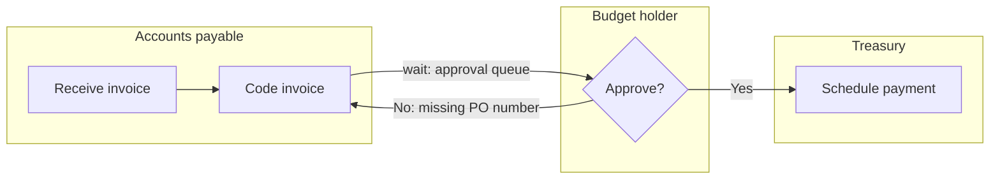

# SIPOC and current-state mapping

## SIPOC

SIPOC stands for Suppliers, Inputs, Process, Outputs, Customers. It is a one-page scoping tool, not a detailed map. Build it in this order, which is not the order of the letters:

1. **Process**: name the process and write 5–7 high-level steps as verb-noun phrases ("Receive invoice", "Match to purchase order", "Approve", "Schedule payment"). More than seven means the scope is too wide or the steps are too detailed.
2. **Start trigger and end event**: the observable event that starts one unit of work, and the one that ends it. Example: start = invoice received in the accounts payable inbox; end = payment released.
3. **Outputs**: what the process produces for each customer (payment, remittance advice, posted ledger entry).
4. **Customers**: who receives each output, internal or external. Add each customer's key requirement (for example, "supplier: paid on the agreed terms").
5. **Inputs**: what the process consumes (invoice, purchase order, receiving record, approval limits).
6. **Suppliers**: who provides each input (supplier, purchasing, warehouse, finance policy).

Also record what is explicitly out of scope, so the team does not drift into mapping the purchasing process when the problem is payment.

## Collecting current-state data

- **Follow a real item.** Pick several recent items, including at least one exception, and trace them through systems and inboxes. Documentation shows the intended process; items show the real one.
- **Interview the doers.** Ask each person: what arrives, from whom, in what shape; what they do; what they check; what goes wrong; where it goes next; how long it waits before they touch it. Ask for a recent specific example rather than a typical one.
- **Pull timestamps.** Workflow, ticketing, ERP, and CRM systems often log status changes. Status-change timestamps give waits between steps; they rarely give touch time, which usually needs observation or a time sample.
- **Estimate touch time honestly.** If you cannot observe, ask for a range for a normal item and a hard item. Record the range and the source.
- **Count rework.** Look for items sent back, reopened, or corrected. The share that returns is 1 − FPY for that step.

State sample size and the date range. A handful of hand-traced items is enough to see the shape of the process; it is not enough to prove a small improvement later.

## Drawing the swimlane map

A swimlane map puts each role or team in its own horizontal lane, so every crossing between lanes is a visible handoff. Conventions:

- One lane per role, not per person. Include the customer and external parties as lanes when they act.
- Rectangles for work steps, diamonds for decisions, and a clear marker for waits (queues, inboxes, approvals pending).
- Draw rework loops as arrows going backward; do not hide them in a note.
- Label each step with touch time and each wait with wait time once measured.
- Map the main path first; add exceptions that affect more than a small share of items or carry high risk.

### Mermaid pattern

Mermaid does not have a native swimlane type; use a flowchart with one subgraph per lane:



Keep node labels short; put times in the step measurement table rather than cramming them into the diagram.

### Text pattern (when Mermaid is not rendered)

```
[AP]       Receive invoice -> Code invoice ---------------------------+
[Manager]                                   (wait) -> Approve? --No--> back to Code invoice
                                                         |Yes
[Treasury]                                               +-> Schedule payment -> END
```

## Value stream mapping (when to use it instead)

A value stream map adds information flow, inventory (queues) between steps, and a timeline ladder of wait versus work. Use it when the process is high volume and repetitive and the goal is flow; use a swimlane map when the problems are handoffs, ownership, and decisions. Many knowledge-work processes need the swimlane first.
